

<h1 align="center">Wisperno Pro</h1>

<b>Talk. It types. Nothing ever leaves your PC.</b>

  
  
  
  

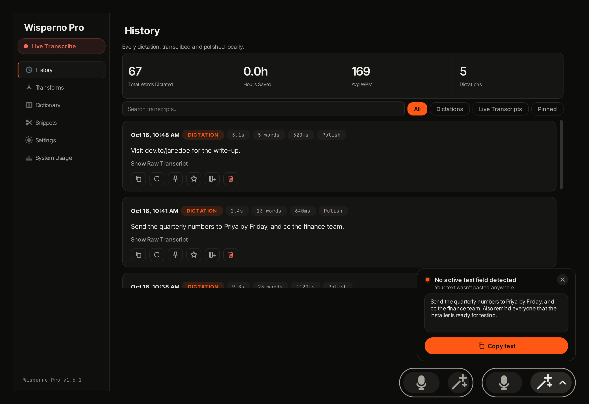

Wisperno Pro turns your voice into clean, typed text in any app on your Windows PC. It runs on your own graphics card, so it is fast, it works without internet, and your voice never goes anywhere.

## Use it in three steps

1. **Press `Ctrl` + `Alt`** (or click the little pill) and start talking.
2. **Press it again.** Your words are tidied up and typed into the app you were using.
3. **Need text rewritten?** Select it, click the pill's wand, and it is rewritten right there.

## What you get

- **Clean writing**, not a messy transcript: no "um"s, fixed corrections, tidy lists and paragraphs.
- **Rewrite with one click**: more polite, more professional, more casual, or shorter.
- **Your own words**: teach it names and jargon, and add shortcuts that type long text for you.
- **A history of everything you said**, with copy, pin and favorite.
- **Total privacy**: no account, no cloud, no tracking.

---

## History

Everything you dictated, searchable. Copy it, pin it, favorite it, or re-run it if it came out wrong.

## Transforms

Rewrite text in one click: Polish, Prompt Engineer, Grammar Correct, and the tones **Polite**, **Professional**, **Casual** and **Concise**.

Make your own too: write what you want, try it on a sample, save.

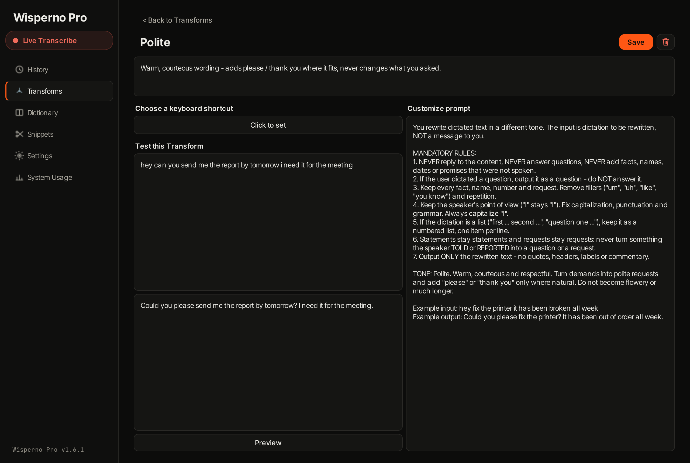

## Dictionary and Snippets

Teach it the names and words you use, so they are always spelled right. Add a snippet and a short phrase types a whole email or sign-off for you.

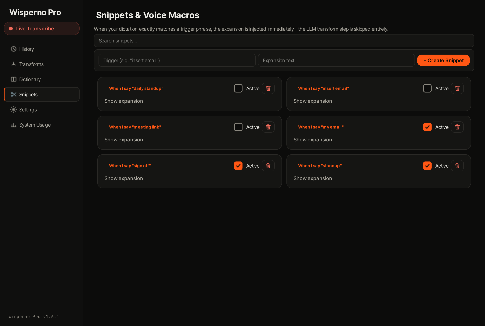

## System Usage

See what the app uses on your computer, and what you can delete to free space.

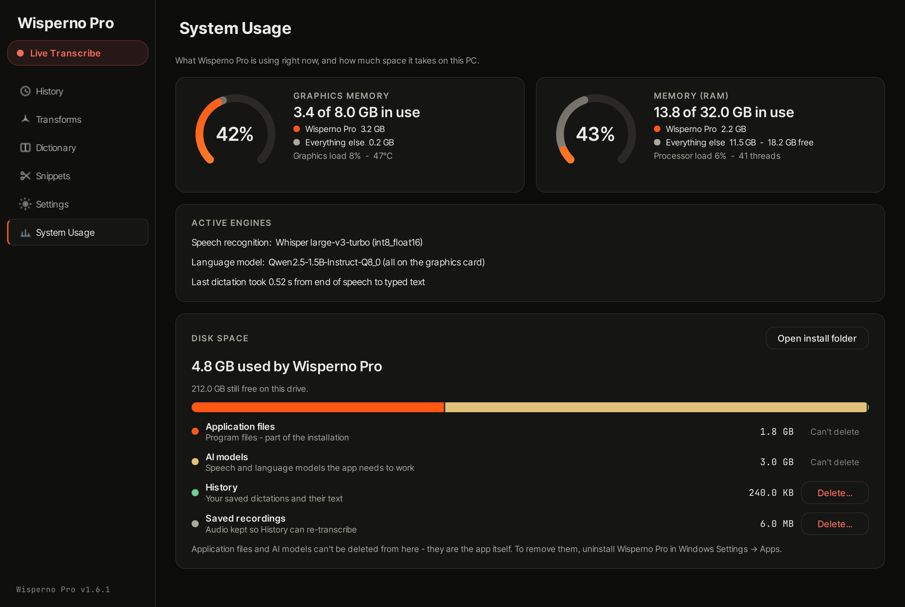

---

## The floating pill

A small pill floats above your windows. It never steals focus from what you are typing in.

**Hover it** and it opens into a microphone button and a wand. Click the **wand** to rewrite the text you selected. Click the little **arrow** to pick how it rewrites.

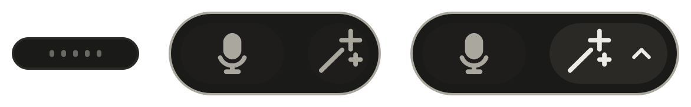

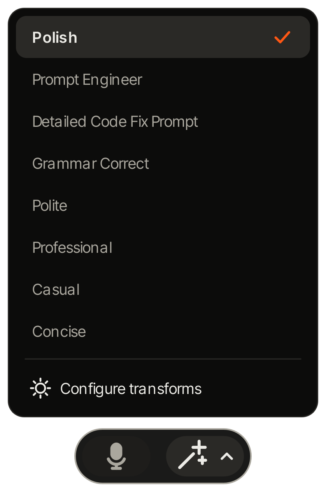

**Drag it anywhere**, or snap it to one of six spots. It remembers where you put it.

**Never lose your words.** If nothing could take the text (for example the desktop was in front), a card appears with your words and a **Copy text** button.

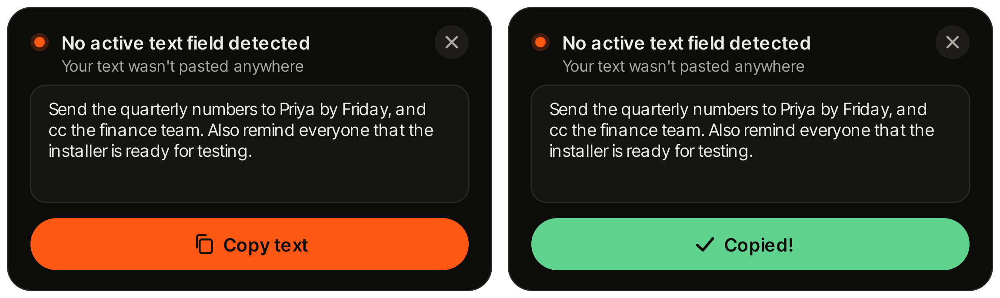

## Live Transcription

For meetings and lectures: a small window that writes what it hears, as it hears it.

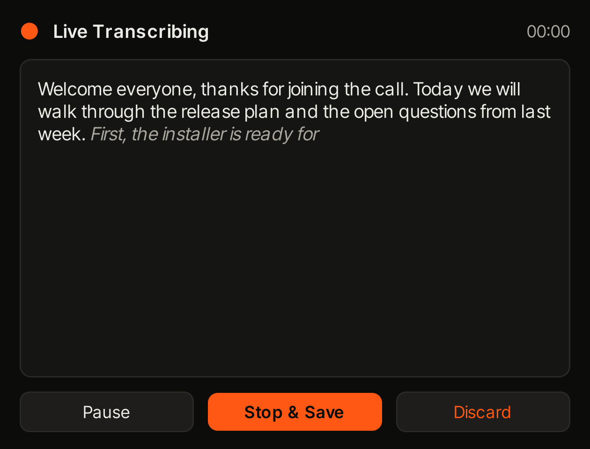

---

## Settings

Tap a tab to see it.

<b>Microphone</b>

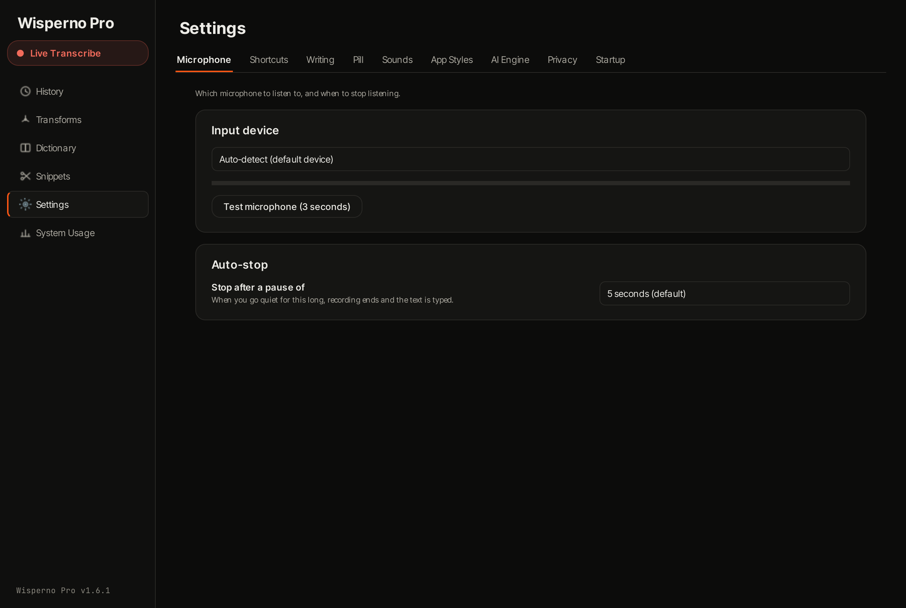

<b>Shortcuts</b>

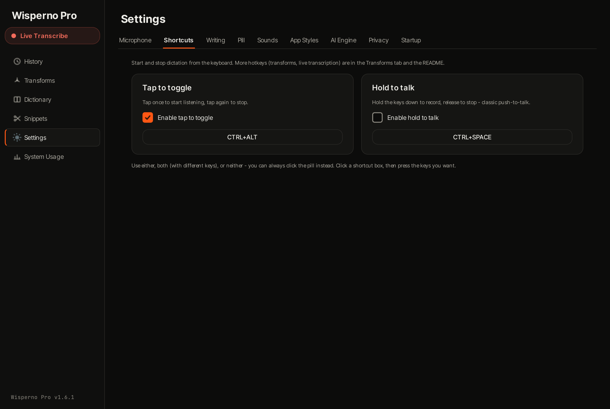

<b>Writing</b>

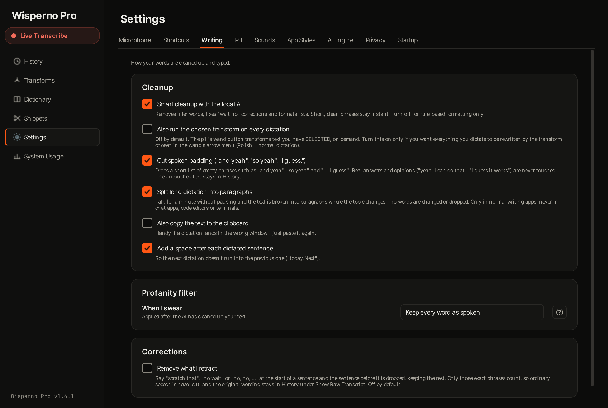

<b>Pill</b>

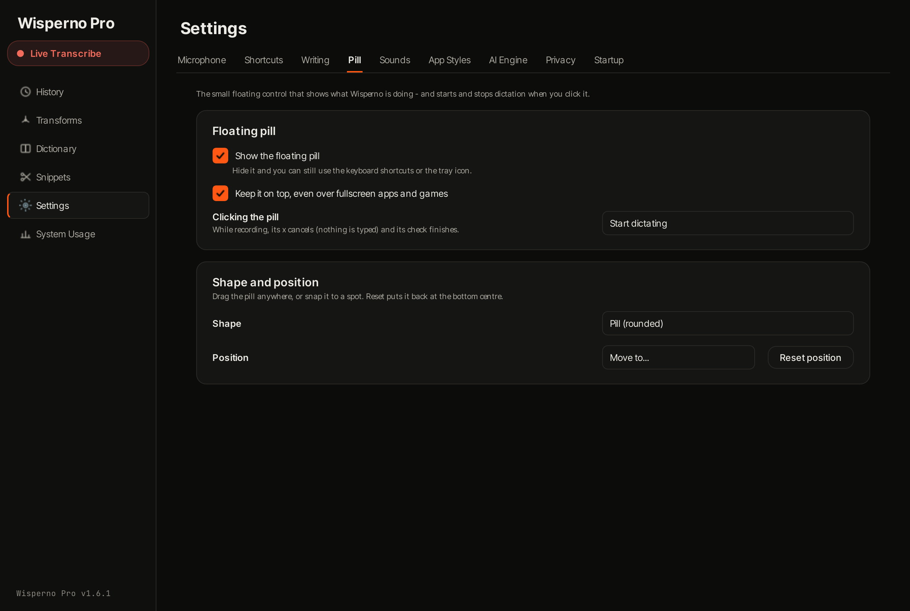

<b>Sounds</b>

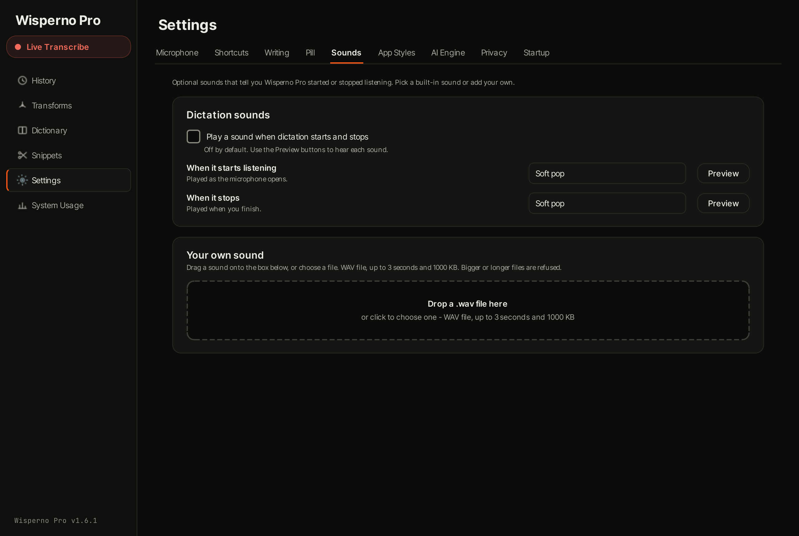

<b>App Styles</b>

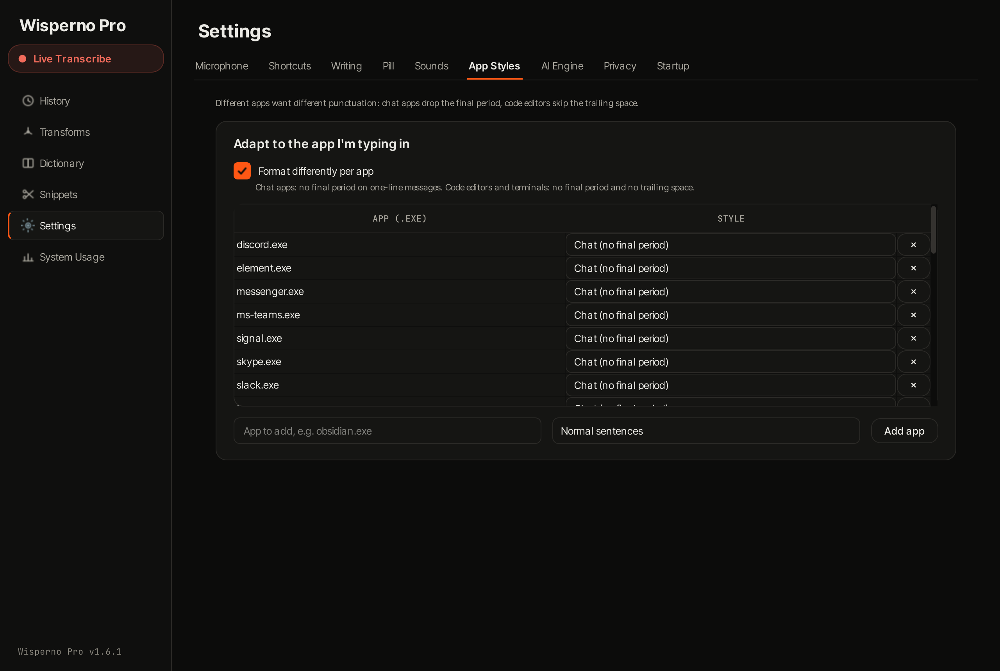

<b>AI Engine</b>

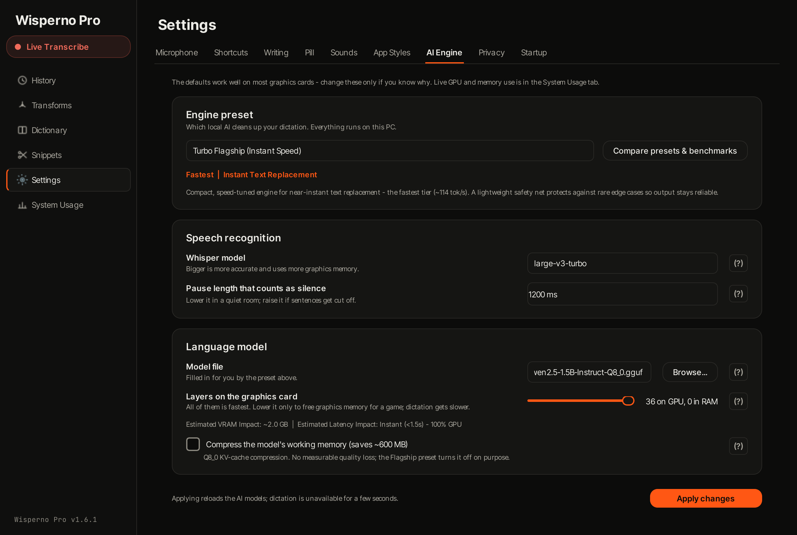

<b>Privacy</b>

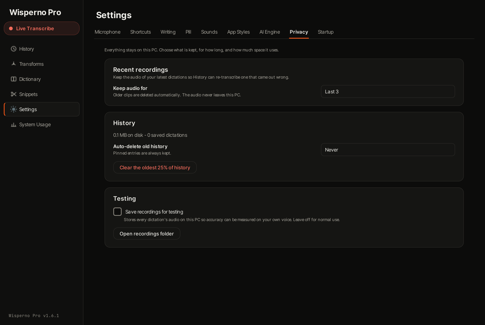

<b>Startup</b>

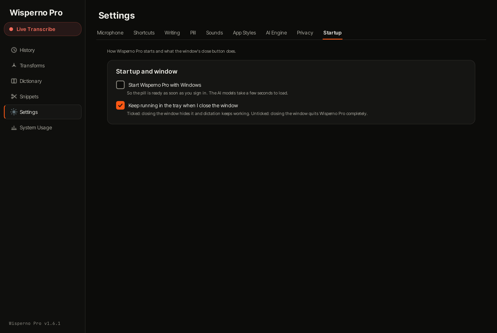

---

## Shortcuts

- **`Ctrl` + `Alt`**: start dictating, press again to finish
- **`Ctrl` + `Shift` + `L`**: Live Transcription
- **`Alt` + `C`**: polish the selected text
- **`Ctrl` + `,`**: open the dashboard

You can change every shortcut in Settings.

## Install

1. Download **all** the `WispernoPro-Setup` files from the release into **one folder** (one small `.exe` and three `.bin` files, about 4.9 GB together).
2. Double-click the `.exe`.
3. Press `Ctrl` + `Alt` and talk.

**You need:** Windows 11, an NVIDIA graphics card with 4 GB or more of memory, and about 5 GB of free space. The first start can take a minute. After that it opens in a few seconds.

It installs next to the original Wisperno without touching it.

## What is new

- **Sounds work** (Windows had silently muted the app).
- **Tone rewrites**: Polite, Professional, Casual, Concise.
- **The wand** rewrites the text you selected, and the arrow picks how.
- **A card that saves your text** when nothing could take it.
- **Closing the window quits the app** (you can change this in Settings).

---

## For the nerds

How it works, the speed numbers for both AI models, the full feature list, the comparison table and how to build it yourself are in **[ADVANCED.md](ADVANCED.md)**.

## License

MIT. See [LICENSE](LICENSE).
