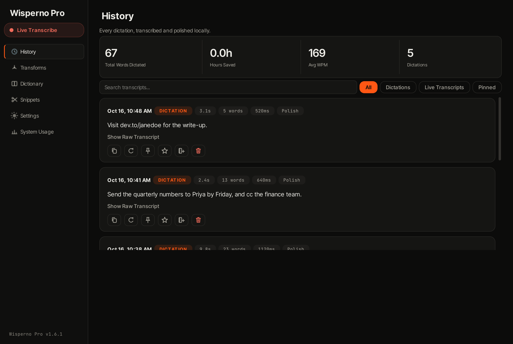
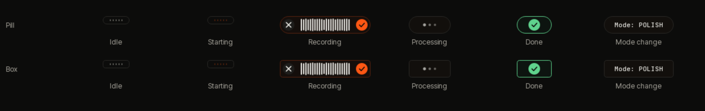
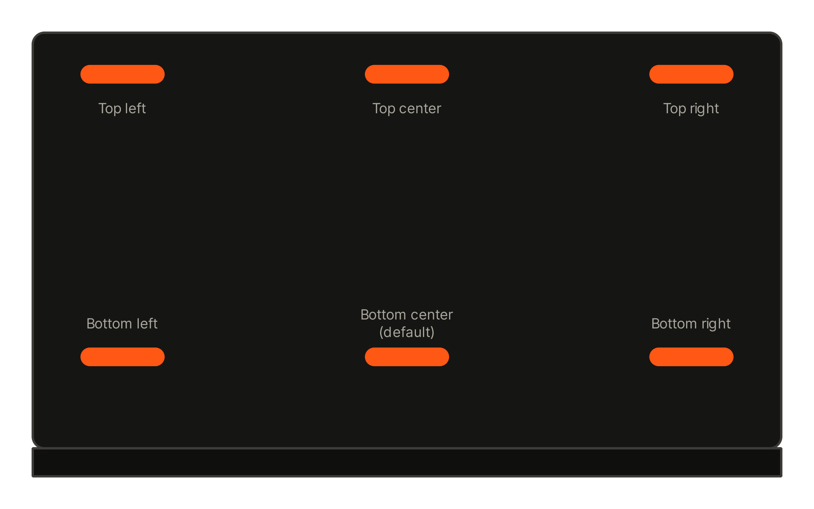
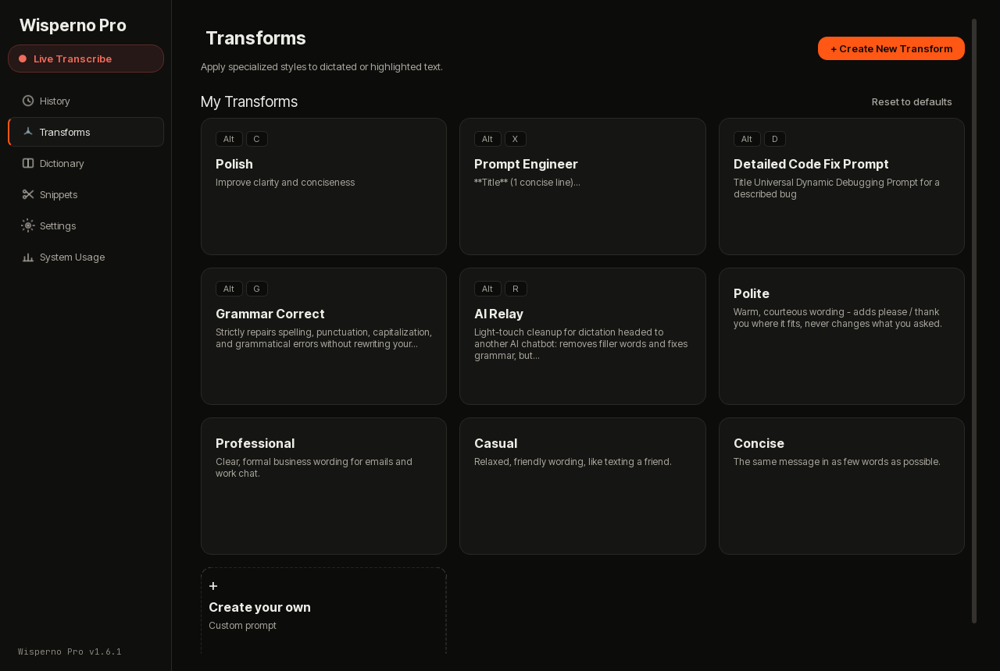
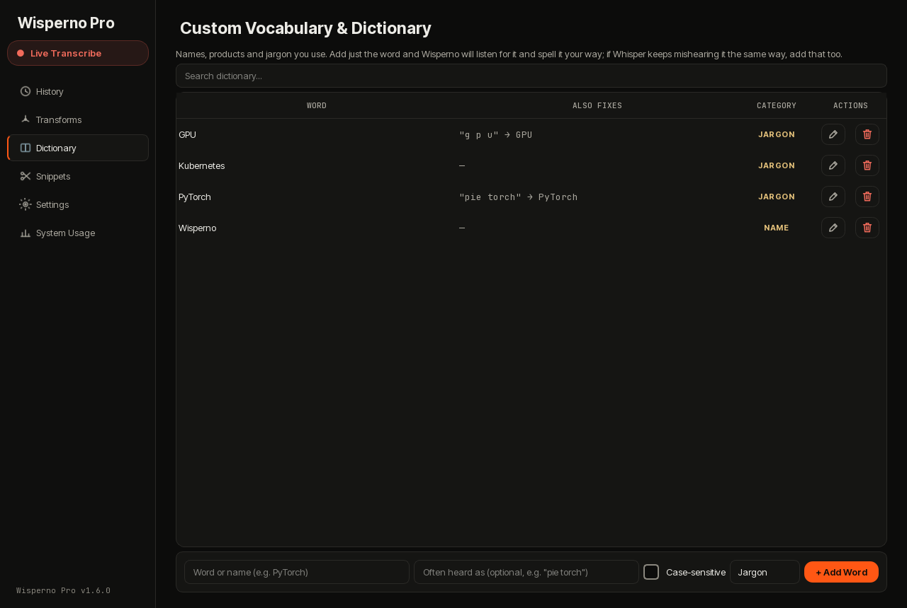
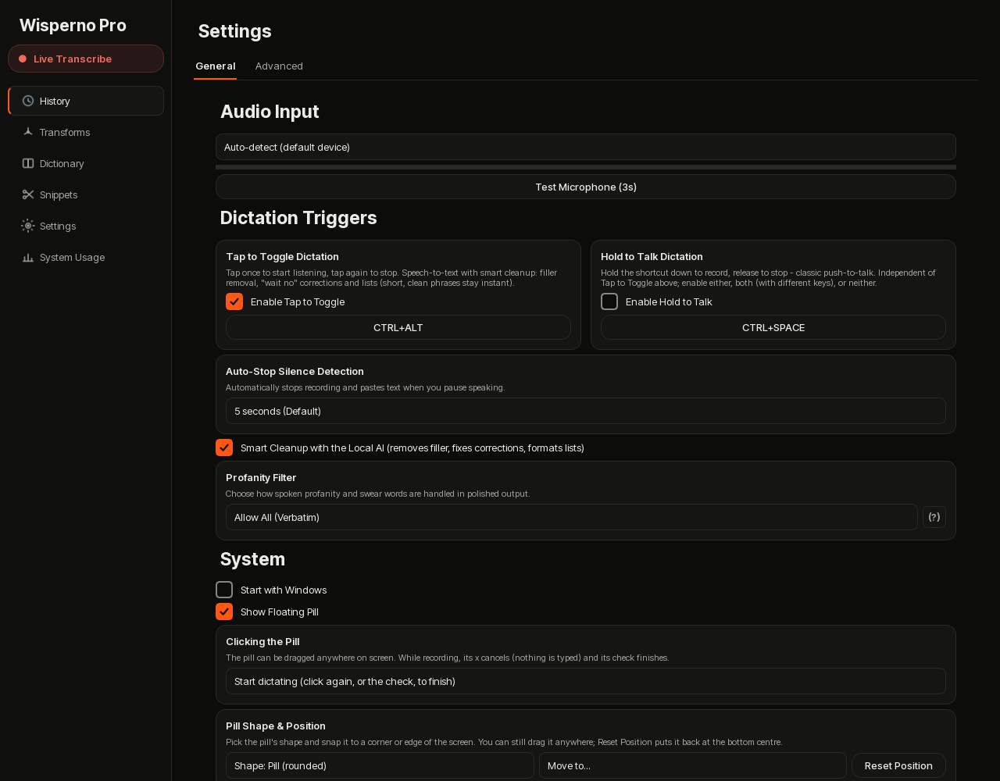
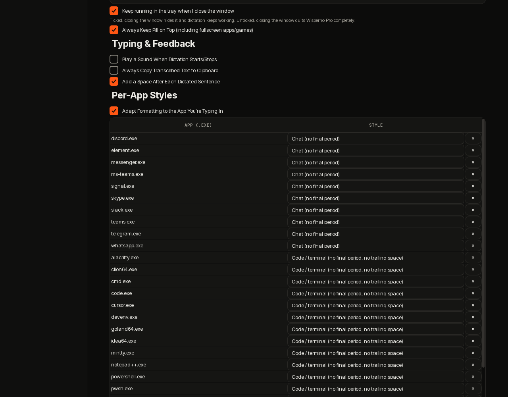
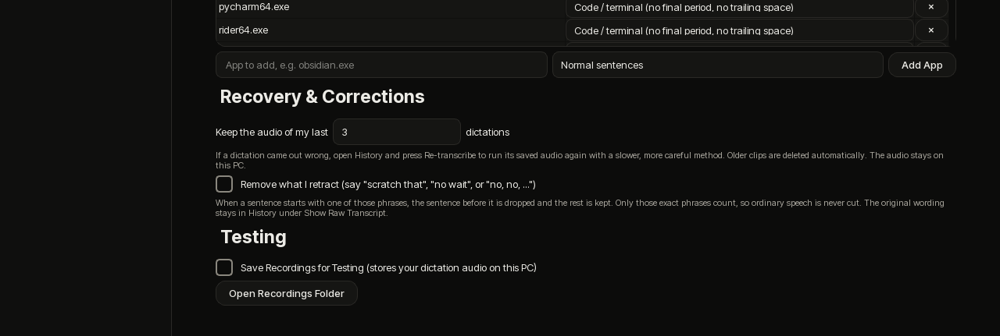

<p align="center"></p>

<h1 align="center">Wisperno Pro</h1>


**Private, offline, GPU-accelerated dictation for Windows.** Press a key (or
click the little pill), speak, and your words are typed into whatever app has
focus - transcribed and cleaned up on your own graphics card. No audio and no
text ever leave your PC.



> Wisperno Pro is a separate app from the original Wisperno: its own installer
> identity, its own `%APPDATA%\WispernoPro` data folder, and it installs next
> to the original without touching it.

## Contents

- [How it works](#how-it-works)
- [The pill](#the-pill)
- [Features](#features)
- [Settings tour](#settings-tour)
- [Default hotkeys](#default-hotkeys)
- [Install](#install)
- [Requirements](#requirements) - [Measured performance](#measured-performance) - [Credits](#credits--third-party-models) - [License](#license)

## How it works

1. **Listen.** Your microphone is opened only while a dictation is running.
2. **Transcribe.** `faster-whisper large-v3-turbo` runs on your GPU (CUDA, int8/fp16).
3. **Clean up.** Either an instant rule-based formatter (sub-second, no AI) or a
   small local language model (`Qwen2.5-1.5B` by default) removes fillers, fixes
   self-corrections and formats lists.
4. **Type.** The result is pasted into the app you were using, with the right
   style for that app (chat apps drop the final period, code editors skip the
   trailing space).

Everything is local. After the models are on disk the app makes zero network calls.

## The pill

A small always-on-top capsule that never steals focus from the app you are
typing into. It stays tiny while idle and grows only when something happens.



| State | What you see |
|---|---|
| Starting | Orange dots sweep while the AI models load (a few seconds on a warm start) |
| Idle | A thin strip of faint bars; grows slightly under the cursor |
| Recording | `x` on the left, a **live waveform of your actual voice**, a check on the right |
| Processing | Three pulsing dots (plus the name of a Transform if one is running) |
| Done | A green check |
| Mode change | A short `Mode: POLISH` toast |

- **Click to dictate.** Click the idle pill to start; click the check to finish
  and type the text, or the `x` to throw the recording away - nothing is typed.
  Settings -> General -> *Clicking the Pill* can instead open the dashboard or
  do nothing (hotkeys only).
- **Drag it anywhere.** It remembers its spot between launches. If that spot is
  no longer on any screen (a monitor was unplugged) it falls back to the default spot.
- **Choose its shape.** *Pill* (fully rounded) or *Box* (rounded rectangle) -
  Settings -> General -> *Pill Shape & Position*.
- **Snap it to a spot.** Six presets (below), from Settings or from the pill's
  right-click menu -> *Move Pill To*.
- **Reset it.** *Reset Position* in Settings, or right-click -> *Reset Pill
  Position*, puts it back at the bottom centre.



## Features

### Dictation
- **Two engines, your choice per trigger.** Instant *Direct Dictation*
  (rule-based, no AI, well under a second) and *Smart Cleanup* with the local AI
  (grammar, fillers, "no wait" corrections, lists).
- **Tap to toggle** (default `Ctrl+Alt`) or **hold to talk**, plus the pill.
- **Auto-stop on silence** - pause for 5 seconds (configurable) and it finishes by itself.
- **Per-app styles.** Chat apps (Discord, Slack, Teams...) drop the final period;
  code editors and terminals also skip the trailing space. Add your own apps.
- **Paragraphs from pauses.** A pause of about 1.3 seconds starts a new paragraph.
- **Spoken domains.** "visit dev dot to slash janedoe" types `visit dev.to/janedoe`;
  "put a dot in the middle" keeps the word *dot*.
- **Lists spoken across pauses.** "I will answer both of your questions... *(pause)*
  First, ... *(pause)* Second, ..." comes out as one list introduced by a colon.

### Live Transcription (`Ctrl+Shift+L`)
A separate streaming mode for meetings, lectures and calls: continuous transcription
in a floating window with Pause, Stop & Save and Discard. About 13x faster than
real time. Design notes: [LIVE_TRANSCRIPTION_ARCHITECTURE.md](LIVE_TRANSCRIPTION_ARCHITECTURE.md).

### Transforms
Re-write dictated or highlighted text with one hotkey each: **Polish**, **Prompt
Engineer**, **Detailed Code Fix Prompt**, **Grammar Correct**, **AI Relay**, plus your own
custom prompts. Highlight text and press a transform's hotkey to polish it in place.



### Dictionary and Snippets
- **Dictionary.** Names, products and jargon you use. Add the word, and optionally
  how Whisper tends to mishear it ("pie torch" -> PyTorch). It biases recognition
  and corrects the spelling afterwards. Ships empty.
- **Snippets / voice macros.** Say a trigger phrase exactly and its expansion is typed
  instantly, skipping the AI.



### Profanity filter
Settings -> General -> *Profanity Filter*, three modes:

| Mode | Result for "that is bullshit" |
|---|---|
| **Allow All (verbatim)** - default | `that is bullshit` |
| **Censor** | `that is b*******` |
| **Remove** | `that is` |

It matches whole words only (so `class`, `assess`, `Scunthorpe` are safe), covers common
inflections and compounds (`motherfucking`, `dumbass`, `dammit`...), and also catches words
the speech model masks itself (`f**king`, `s**t`). In *Allow* mode a masked word is restored
to what you actually said. A capitalised *Dick* before another capitalised name is treated as
a person, not slang. In *Allow* mode a safety net also catches the cleanup AI quietly dropping a
swear word and falls back to your original wording.

### When a dictation comes out wrong
- **Keeps your last 3 recordings** (choose 0, 3, 5 or 10 in Settings -> *Recovery &
  Corrections*). Older ones are deleted automatically, and the audio never leaves your PC.
- **Re-transcribe.** In History, press *Re-transcribe* on an entry that still has its audio.
  It re-runs the recording with a slower, more careful method - no voice-activity trimming,
  no confidence rejection, a wider search, and retries at higher temperature - then replaces
  that entry and copies the result to your clipboard so you can paste it where it belongs.
  Nothing is typed into another window by itself.
- **Raw transcript** is always kept under *Show Raw Transcript* in History.

### Retractions ("scratch that") - opt-in
Settings -> *Recovery & Corrections* -> *Remove what I retract*. When a sentence **starts**
with a retraction phrase, the sentence before it is dropped and the rest is kept:

> "Let's meet on Monday. No, no, let's meet on Tuesday." -> `Let's meet on Tuesday.`

Recognised phrases: *scratch that*, *no wait*, *wait no*, *ignore that*, *delete that*,
*start over*, and - only when followed by a comma or full stop - *no, no*, *actually no*,
*never mind*. Ordinary sentences like "No, no problem" or "Actually no one came" are never cut.
This is deliberately rule-based rather than asking a small AI what you "meant": a small model
can silently delete real content. It is **off by default**, and the original wording stays in
*Show Raw Transcript*. It does not (yet) fix a change mid-sentence such as "Monday, no wait, Tuesday".

### History, system usage and more
- **History** - every dictation with word, time, WPM and count summaries, search,
  filters (All / Dictations / Live Transcripts / Pinned), pin, favorite, copy, one-click
  *+ Dictionary*, and *Re-transcribe*.
- **System Usage** - live GPU memory and RAM with Wisperno's own share shown separately.
- **Two engine presets** - *Turbo Flagship* (default, Qwen2.5-1.5B, ~110 tokens/s) and *Standard*
  (Llama-3.2-3B, most consistent cleanup). See [BENCHMARKS.md](BENCHMARKS.md).
- **Optional audio cues**, start with Windows, minimise to tray, always-on-top pill (including
  over fullscreen apps).
- **A dark, warm-black theme** with one orange accent, taken from devbhamaria.com, with Inter
  Tight and JetBrains Mono bundled.

## Settings tour







Checkboxes show an orange box with a tick when **on** and an empty grey outline when **off**.
*Keep running in the tray when I close the window* controls what the window's close button
does: ticked hides the window and keeps dictation working; unticked quits the app completely.

## Default hotkeys

| Hotkey | Action |
|---|---|
| `Ctrl+Alt` | Tap to toggle dictation (tap to start, tap to stop) |
| `Ctrl+Space` | Hold to talk (off by default - enable in Settings) |
| `Ctrl+Shift+L` | Start/stop a Live Transcription session |
| `Alt+C` (alias `Alt+P`) | Polish - the default transform |
| `Alt+X` | Prompt Engineer transform |
| `Alt+V` | Detailed Code Fix Prompt transform |
| `Ctrl+Shift+B` | Cycle active transformation mode |
| `Ctrl+,` | Open Settings & Dictionary |
| `Ctrl+Shift+H` | Toggle the dashboard window |

Any transform's own hotkey also polishes the current text selection if nothing is spoken.
Every shortcut can be changed in Settings.

## Install

**From a release (recommended).** Download *every* `WispernoPro-Setup-v1.0.0` file from the
release into **one folder** - the `.exe` and all the numbered `.bin` parts (the installer
uses disk spanning, so it reads the parts from beside itself) - then run the `.exe`. It upgrades
an existing Wisperno Pro in place, keeping your settings, history and dictionary. The first
launch after installing can take about a minute while Windows scans the new files; later
launches take a few seconds.

**From source:**

```
git clone https://github.com/Burthcer/wisperno-pro.git
cd wisperno-pro
py -3.12 -m venv .venv
.venv\Scripts\pip install -r requirements.txt
.venv\Scripts\python download_models.py
.venv\Scripts\python main.py
```

`requirements.txt` pins `torch`/`torchaudio` 2.6.0 from the CUDA 12.4 index - an unpinned install
gets a CPU-only build. More detail: [INSTALL.md](INSTALL.md). To regenerate the screenshots in
this README (with made-up demo data, never your own history): `python scripts/capture_readme_screenshots.py`.

## Requirements

See [SYSTEM_REQUIREMENTS.md](SYSTEM_REQUIREMENTS.md) - short version: Windows
11 64-bit, an NVIDIA GPU with 4GB+ VRAM (2GB minimum triggers an automatic
CPU-compatibility fallback), ~8.5GB free disk space.

## Measured Performance

Not projected - measured on the actual shipping hardware target (RTX 4070
Laptop GPU, 8GB VRAM) via `tests/benchmark_models.py` and
`tests/test_startup_time.py`, both of which ship in this repo so you can
reproduce it yourself. Full writeup, including exactly what changed and
why, is in [BENCHMARKS.md](BENCHMARKS.md).

| Preset | VRAM | System RAM | Decode Speed | 100-word Latency | Fidelity |
|---|---|---|---|---|---|
| **Turbo Flagship (default)** | 3,491 MB | 2,311 MB | **113.8 tok/s** | 0.82s | 97.6% |
| Standard | 3,691 MB | 2,559 MB | 91.7 tok/s | 1.04s | 98.8% |

Both presets stay under 4GB of GPU memory and under the 5GB system RAM
budget. The VRAM column is whole-GPU usage during the benchmark (Whisper +
LLM + Windows and any other app on the GPU), not Wisperno alone - the
System Usage tab shows Wisperno's own share. Both tiers pass
the app's 5-prompt adversarial conversational-trap suite in real usage
(`sanity_check()` runs on every transform regardless of the raw fidelity
score above - see BENCHMARKS.md for what that number does and doesn't cover).

**On sourcing these specific numbers:** these are the project's own
documented figures (`BENCHMARKS.md`, dated 2026-09-09), not this session's
own from-scratch measurement - a from-scratch re-run was attempted but the
dev machine's GPU had the user's own live, already-running Wisperno
instance resident on it at the time (confirmed via `nvidia-smi`'s
per-process memory query), which contaminates any fresh reading rather than
producing a second clean data point. What *is* independently verified: the
VRAM figures above are within 2MB of this session's own previously-measured
clean baseline on the prior engine version - strong evidence the speed
change is real and isolated (a pure engine upgrade, not a different model
or quantization), even without a fresh from-scratch confirmation this round.

## What Changed: Inference Engine Upgrade

`llama-cpp-python` was upgraded `0.2.90 -> 0.3.4 -> 0.3.26` (version-bisected
against a range of releases that crash on this hardware, to find the newest
stable one). Net effect: **every preset decodes roughly 20-30% faster**
(Turbo Flagship: 89.3 -> 113.8 tok/s) with identical fidelity and unchanged
VRAM - a pure engine-level win, not a model or quantization change. See
[BENCHMARKS.md](BENCHMARKS.md) for the full before/after and how to
reproduce it.

**Cold start** (`tests/test_startup_time.py`, all 5 assertions passing):
Whisper (`large-v3-turbo`, CUDA, int8_float16) loads in **2.8-5.2s** across
repeated runs (well under the 10s regression ceiling this test guards - a
prior bug made this take ~173s via an unwanted Hugging Face network probe).
The LLM loads from its local GGUF in **~1.1-1.2s**, consistent across both
presets.

**Real speech transcription (not a synthetic tone):** a genuine
TTS-generated 9.75s spoken sample was transcribed by the actual
`faster-whisper` pipeline in 0.945s - **RTF 0.097** (~10.3x faster than
real-time) - and came back **word-for-word verbatim** against the known
script, punctuation and filler words included, before any LLM polish is
even applied.

**Resource ceiling during active inference** (paired `psutil`/`pynvml`
sampling through one live LLM transform call): peak process CPU 92.4%,
peak GPU compute utilization 79% - consistent with the 77% observed during
the full four-preset run above.

## How It Compares

Wispr Flow (the product Wisperno takes after) is cloud-only: it has no
offline mode at any pricing tier, and every word dictated is sent to a
subprocessor stack (OpenAI, Anthropic, Baseten, AWS) for transcription and
cleanup, even under its "zero data retention" privacy setting. A
self-hosted full Whisper (`large-v3`) is private but heavy - roughly 10GB
VRAM to run comfortably. Wisperno's own numbers below are the ones already
measured and shipped in `config/config.yaml`/`SYSTEM_REQUIREMENTS.md`, not
projections.

| | Wispr Flow | Local Whisper `large-v3` | Wisperno |
|---|---|---|---|
| Where audio is processed | Cloud (OpenAI + subprocessors) | On-device | On-device |
| Works with no internet | Never | Yes | Yes, after first model fetch |
| STT backbone | OpenAI Whisper (cloud) + fine-tuned Llama | `large-v3` (full) | `faster-whisper large-v3-turbo` (CTranslate2, ~7x faster decode than full `large-v3`) |
| VRAM floor | None (any device + internet) | ~10GB | 4GB (2GB triggers automatic CPU fallback) |
| Marginal cost per use | Subscription | None (hardware only) | None (hardware only) |
| Text cleanup/formatting | Cloud LLM | None built-in | Local quantized LLM (llama.cpp, 2 presets, both under 4GB) |

## Credits & Third-Party Models

Wisperno is glue code and product design around other people's models and
runtimes - full credit belongs to them:

- **[faster-whisper](https://github.com/SYSTRAN/faster-whisper)** (MIT) /
  **[CTranslate2](https://github.com/OpenNMT/CTranslate2)** (MIT) - the STT
  inference engine.
- **[Whisper](https://github.com/openai/whisper)** (`large-v3-turbo`, MIT) -
  OpenAI's speech recognition model.
- **[llama.cpp](https://github.com/ggml-org/llama.cpp)** (MIT) /
  **[llama-cpp-python](https://github.com/abetlen/llama-cpp-python)** (MIT) -
  the local LLM inference engine.
- **[Qwen2.5](https://github.com/QwenLM/Qwen2.5)** (Apache 2.0, Alibaba
  Cloud) - the Turbo Flagship and Standard LLM presets, via
  [bartowski's GGUF quantizations](https://huggingface.co/bartowski).
- **Llama 3.2** (Meta's [Llama 3.2 Community License](https://github.com/meta-llama/llama-models/blob/main/models/llama3_2/LICENSE)) -
  the fallback LLM preset. Built with Llama.
- **[PySide6](https://doc.qt.io/qtforpython-6/)** (LGPLv3) - the tray/dashboard UI.
- **[PyAV](https://github.com/PyAV-Org/PyAV)** (BSD-3-Clause) - audio I/O.

## License

Wisperno's own code is [MIT](LICENSE) - v1.0.0. The third-party models and
runtimes above keep their own licenses; see each project for terms,
particularly Meta's Llama 3.2 Community License if you redistribute a build
that bundles the Llama-3.2 fallback weights.
